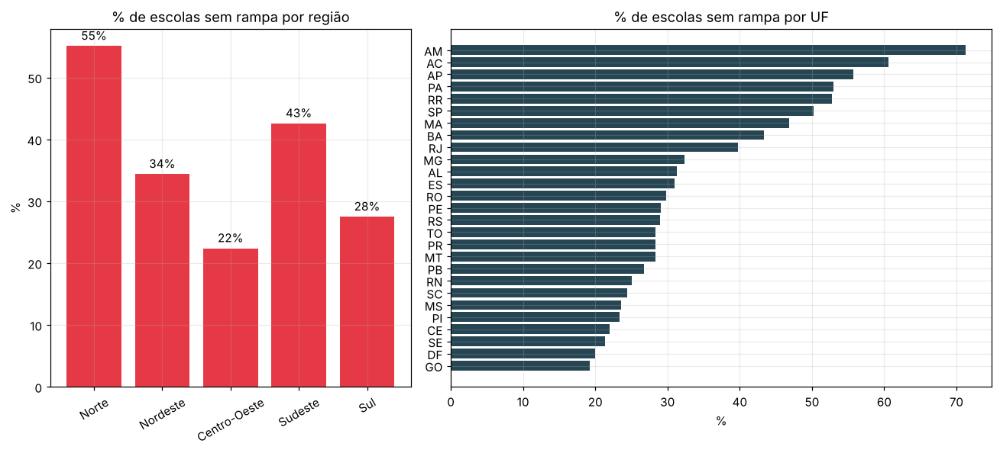
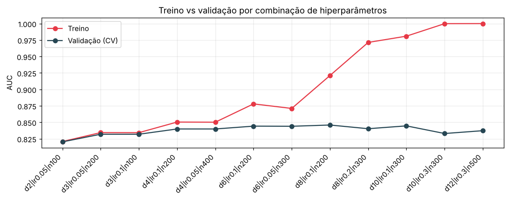
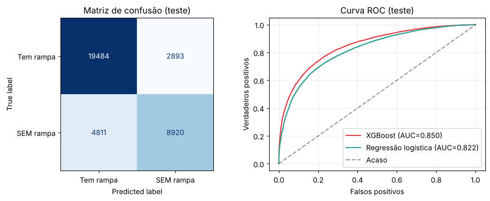
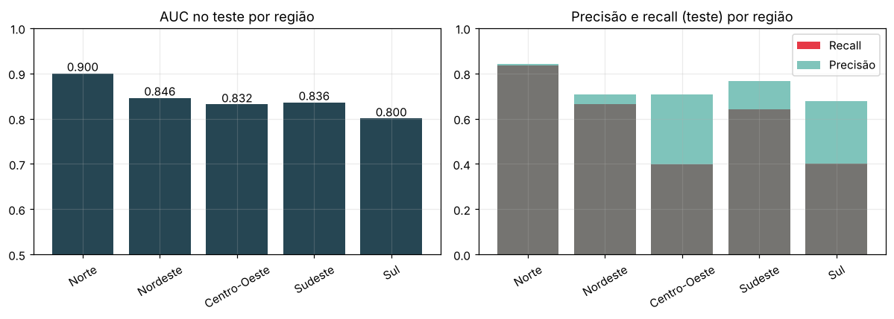

# Relatório de IA & Machine Learning

# ♿ CitizenTech · Acessibilidade Urbana ♿

## 🌐 Global Solution 2026.2 · FIAP 🌐
## 💻 Engenharia de Software · IA & Machine Learning 💻

### 👥 Integrantes
| Nome | RM |
|---|---|
| André Luiz Fernandes de Queiroz | 554503 |
| Marcos Vinicius da Silva Costa | 555490 |
| Paulo Poças | 556080 |
| Rafael Bocchi | 557603 |
| Rafael Federici de Oliveira | 554736 |

## 1. Problema e pergunta de ML

| Campo | Conteúdo |
|---|---|
| Cidadão beneficiado | Pessoas com deficiência ou mobilidade reduzida |
| Problema em uma frase | Estabelecimentos têm barreiras de acessibilidade e não sabem quais são nem a quem recorrer |
| Como funciona | Questionário e medições guiadas → **triagem** de possíveis barreiras → indicação de parceiros especializados |
| O que **não** fazemos | Obras, adaptações ou cursos; o diagnóstico é triagem e **não substitui** avaliação técnica presencial |
| Pergunta de ML | *dadas as características de uma escola e os demais itens de acessibilidade que ela declara, qual a probabilidade de **faltar rampa de acesso**?*  |
| ODS | 4 (educação inclusiva), 10 (redução das desigualdades) e 11 (cidades acessíveis) |

É uma **classificação binária** (1 = falta rampa) que espelha a triagem da plataforma: com poucas respostas, estimar uma barreira provável ainda não verificada. Como a base é nacional, também **comparamos as regiões do Brasil**.

## 2. Dados reais e públicos
| Item | Detalhe |
|---|---|
| Fonte | INEP, Censo Escolar da Educação Básica (microdados, tabela de escolas) |
| Link | https://www.gov.br/inep/pt-br/acesso-a-informacao/dados-abertos/microdados/censo-escolar |
| Período | Censo Escolar **2025** (`NU_ANO_CENSO` = 2025) |
| Amostra | **Brasil inteiro**: 214.192 escolas (27 UFs, 5 regiões); **180.540 em atividade** usadas no modelo |
| Natureza | Reais, públicos e **autodeclarados**; sem dados pessoais (removemos CNPJ e nome da escola) |

Usamos escolas como *proxy* de estabelecimento porque não há base pública oficial de acessibilidade para comércio e serviços. Das escolas do arquivo, 29.780 estão paralisadas e 3.872 extintas, e ficaram de fora.

**Alvo:** `y_sem_rampa = 1` quando `IN_ACESSIBILIDADE_RAMPAS = 0`. **38,0%** das escolas em atividade não declaram rampa e 62,0% declaram: a classe é moderadamente desbalanceada, e por isso a **acurácia sozinha engana** (um modelo que sempre dissesse "tem rampa" acertaria 62%).

**O problema não é igual no país:**
- **Região:** Norte **55,1%**, Sudeste 42,6%, Nordeste 34,4%, Sul 27,5% e Centro-Oeste **22,4%**. Por UF, vai de 19,2% (GO) a 71,3% (AM).
- **Zona:** rural **53,7%** (50.763 escolas) contra urbana 31,9% (129.777).
- **Rede:** municipal 41,1%, privada 34,4%, estadual 32,7% e federal 10,2% (716 escolas). Há contrastes: no Norte as municipais chegam a 61,9% e as privadas ficam em 22,4%; no Sudeste as privadas (45,6%) superam as estaduais (40,9%) e as municipais (41,4%).

## 3. Modelo escolhido
**XGBoost.** Os dados são tabulares (cerca de 200 variáveis binárias e contagens); o modelo aprende interações entre variáveis e aceita valores ausentes. **Random Forest** seria uma alternativa, mas tende a exigir mais árvores para o mesmo desempenho; **MLP** costuma render menos que árvores em dados tabulares e é mais difícil de explicar; **LSTM** serve a séries temporais (não temos sequência); **KMeans + PCA** é não supervisionado e a nossa pergunta tem rótulo. Como **referências** (não são o modelo final), usamos um classificador de classe majoritária e uma **regressão logística**.

## 4. Preparação dos dados e divisão treino/teste
- **Vazamento de dados:** `IN_ACESSIBILIDADE_INEXISTENTE = 1` implica "sem rampa" em **100%** dos casos (38.790 escolas, nenhuma com rampa). Dar essa coluna ao modelo seria entregar a resposta, então ela foi **removida** das entradas.
- **Código 88888** ("não informado") em 26 colunas de quantidade (`QT_*`) foi convertido em **ausente**; restaram 24.673 valores ausentes (0,06% das células).
- Removemos identificadores, geografia, datas, CNPJ, colunas esparsas de vínculo/parceria, o alvo, o vazamento e colunas constantes ou com mais de 50% de ausentes (`TP_OCUPACAO_GALPAO`): ficaram **214 variáveis**, sendo 197 de perfil e estrutura da escola e 17 de outros itens de acessibilidade. **Região e UF não entram como entrada**; servem para comparar e estratificar.
- **Divisão 80/20 estratificada por região e alvo** (semente 42): **144.432** escolas no treino e **36.108** no teste, ambos com 38,0% sem rampa. Assim, cada região mantém a mesma proporção de barreiras nas duas partes. O teste só foi usado na avaliação final.

## 5. Treino com diferentes hiperparâmetros
Variamos 3 hiperparâmetros do XGBoost que controlam a complexidade (`max_depth`, `learning_rate` e `n_estimators`) em **12 combinações**, de modelos simples a propositalmente complexos, com **validação cruzada estratificada de 5 partições somente no treino** e métrica **AUC** (60 treinos, cerca de 18 minutos).

| # | max_depth | learning_rate | n_estimators | AUC treino (CV) | AUC validação (CV) | Diferença |
|---|---|---|---|---|---|---|
| 1 | 2 | 0,05 | 100 | 0,8208 | 0,8203 | 0,0006 |
| 2 | 3 | 0,05 | 200 | 0,8344 | 0,8319 | 0,0025 |
| 3 | 3 | 0,10 | 100 | 0,8343 | 0,8319 | 0,0024 |
| 4 | 4 | 0,10 | 200 | 0,8504 | 0,8399 | 0,0104 |
| 5 | 4 | 0,05 | 400 | 0,8502 | 0,8399 | 0,0103 |
| 6 | 6 | 0,10 | 200 | 0,8780 | 0,8442 | 0,0338 |
| 7 | 6 | 0,05 | 300 | 0,8711 | 0,8440 | 0,0270 |
| 8 **←** | 8 | 0,10 | 200 | 0,9211 | 0,8459 | 0,0752 |
| 9 | 8 | 0,20 | 300 | 0,9714 | 0,8403 | 0,1312 |
| 10 | 10 | 0,10 | 300 | 0,9809 | 0,8446 | 0,1363 |
| 11 | 10 | 0,30 | 300 | 0,9999 | 0,8330 | 0,1669 |
| 12 | 12 | 0,30 | 500 | 1,0000 | 0,8373 | 0,1627 |

**Melhor combinação:** profundidade 8, taxa de aprendizado 0,1 e 200 árvores (AUC de validação **0,846** na validação cruzada, média das 5 partições; na tabela, 0,8459).

## 6. Resultados em treino e teste
| Métrica | Treino | Teste |
|---|---|---|
| Acurácia | 0,831 | 0,787 |
| Precisão | 0,814 | 0,755 |
| Recall | 0,721 | 0,650 |
| F1 | 0,765 | 0,698 |
| AUC | 0,914 | **0,850** |

**Comparação no teste:**
| Modelo | Acurácia | Precisão | Recall | F1 | AUC |
|---|---|---|---|---|---|
| Classe majoritária (referência) | 0,620 | 0,000 | 0,000 | 0,000 | 0,500 |
| Regressão logística (referência) | 0,767 | 0,717 | 0,638 | 0,675 | 0,822 |
| **XGBoost** | **0,787** | **0,755** | **0,650** | **0,698** | **0,850** |

Matriz de confusão do XGBoost no teste: **8.920** acertos ao apontar "sem rampa", **2.893** alarmes falsos, **4.811** barreiras não detectadas e **19.484** acertos em "tem rampa".

### Overfitting
Há **sobreajuste moderado**: AUC de 0,914 no treino contra 0,850 no teste (diferença de 0,064) e acurácia de 0,831 contra 0,787. A tabela da seção 5 mostra a causa: a diferença entre treino e validação cresce de 0,001 (profundidade 2) para 0,163 e 0,167 (profundidades 12 e 10 com taxa 0,3), com AUC de treino de ~1,00. **Nenhuma combinação mais complexa superou a validação da melhor** (0,8459); as profundidades 10 e 12 ficaram entre 0,833 e 0,845. Um modelo mais simples (profundidade 6, 200 árvores) fica a apenas 0,0017 do melhor (0,8442), com diferença de 0,034 entre treino e validação, e seria uma escolha defensável. O AUC de validação cruzada (0,846) e o do teste (0,850) são muito próximos, o que indica que o teste não foi contaminado pela escolha dos hiperparâmetros.

Com a base nacional, o XGBoost agrega um ganho **moderado** sobre a regressão logística (+0,028 de AUC e +0,023 de F1): a regressão logística, bem mais leve, já captura boa parte do sinal.

### Resultado por região
O modelo foi treinado com o país inteiro e avaliado no teste separado por região.

| Região | Escolas (teste) | % real sem rampa | AUC | Precisão | Recall (corte 0,50) | Recall (corte 0,35) |
|---|---|---|---|---|---|---|
| Norte | 4.441 | 55,1% | 0,900 | 0,841 | 0,837 | 0,891 |
| Nordeste | 11.998 | 34,4% | 0,846 | 0,709 | 0,666 | 0,782 |
| Centro-Oeste | 2.131 | 22,4% | 0,832 | 0,706 | 0,398 | 0,589 |
| Sudeste | 12.284 | 42,6% | 0,836 | 0,766 | 0,641 | 0,778 |
| Sul | 5.254 | 27,5% | 0,800 | 0,678 | 0,400 | 0,586 |

- O **AUC é parecido nas regiões** (0,80 a 0,90): o modelo **ordena bem** as escolas por probabilidade de barreira em todo o país.
- O **recall com corte de 50% muda muito**: 0,84 no Norte e ~0,40 no Centro-Oeste e no Sul, onde a barreira é mais rara (22% e 28%). Um corte único **deixa passar muitas barreiras** nessas regiões. Baixando o corte para 0,35, o recall sobe para ~0,59, ao custo de menor precisão e mais alarmes falsos.

### Faixas de risco
A plataforma precisa de uma **probabilidade** para priorizar. Dividindo as escolas do teste em faixas:

| Faixa | Escolas (teste) | % que realmente não tem rampa |
|---|---|---|
| Baixa (< 35%) | 20.276 | 15,4% |
| Média (35–65%) | 7.433 | 48,6% |
| Alta (≥ 65%) | 8.399 | **83,3%** |

## 7. Conclusão e leitura para o cidadão
1. **É possível triar a falta de rampa com dados de baixo custo:** AUC de 0,85 no teste, contra 0,50 do acaso e 0,82 da regressão logística.
2. **É uma triagem, nunca um laudo.** Quando o modelo aponta "sem rampa", acerta **76%** das vezes e encontra **65%** das escolas que realmente não têm rampa; 4.811 barreiras passariam despercebidas.
3. **A probabilidade permite priorizar:** na faixa Alta, 83% das escolas realmente não têm rampa, contra 15% na faixa Baixa. Os estabelecimentos da faixa Alta devem ser encaminhados primeiro a parceiros especializados.
4. **O problema não é igual no país** (de 22,4% no Centro-Oeste a 55,1% no Norte, e mais grave na zona rural), e **um corte único de 50% não funciona igual em todas as regiões**. Por isso a plataforma deve usar **probabilidade e faixas de risco**, e não um sim/não único.

Para o cidadão, isso significa descobrir e tratar a barreira **antes** de chegar à porta, conectando o estabelecimento a quem pode avaliar e resolver.

### Integração com a API em C#
O notebook exporta `saidas/previsoes_escolas_oof.csv` com as 180.540 escolas em atividade (faixa Baixa: 101.155; Média: 37.388; Alta: 41.997), com previsões obtidas por **validação cruzada** para que cada escola receba a probabilidade de um modelo que **não a viu** no treino. A API em C# importa o arquivo e informa a probabilidade de faltar rampa ao diagnosticar uma escola pelo código INEP.

### Limitações
- Dados **autodeclarados**: "não declarou rampa" pode significar "não tem" **ou** "não informou".
- Escolas como *proxy* de estabelecimentos: com dados reais de parceiros, o modelo deve ser **retreinado e revalidado**.
- Divisão **aleatória**: escolas da mesma rede ou município podem se parecer, o que tende a deixar o resultado um pouco otimista.
- O modelo estima a **probabilidade** de falta de rampa, não a conformidade com a NBR 9050 (que exige medições presenciais).
- Uma escola do arquivo do INEP vem **sem a região preenchida** e fica fora das tabelas por região (a soma das cinco regiões é 180.539, e não 180.540).
